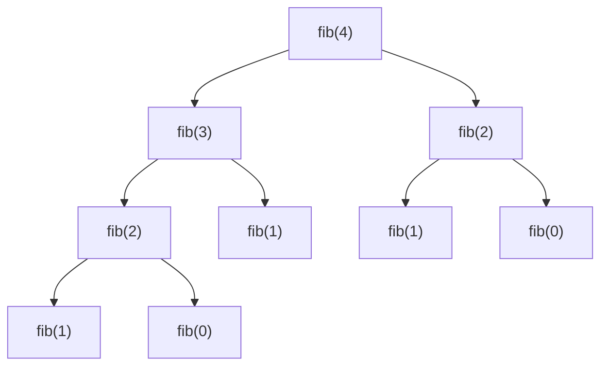

> **In one sentence:** Big-O tells you how the work an algorithm does (time) or the memory it needs (space) **grows as the input gets bigger**, so you can compare solutions without running them. Interviewers ask about it in almost every question, so this topic comes first.

## 1. Why we need it

Suppose two people solve "does this array contain a duplicate?". One finishes in 2 ms on your laptop, the other in 9 ms. Which algorithm is better?

You cannot tell from that. The answer depends on the computer, the programming language, what else is running, and above all **how big the input was**. On 10 items both are instant. On 10 million items one of them may take a second and the other three hours.

Big-O removes all of that noise. It ignores the machine and answers one question:

> If the input gets **10× bigger**, how much **more work** does the algorithm do?

- Work grows 10× as well → **linear**, O(n).
- Work grows 100× → **quadratic**, O(n²).
- Work barely changes → **constant** or **logarithmic**.

That growth pattern is the "shape" of the algorithm. It is what decides whether a solution survives large inputs.

## 2. What exactly do we count?

We do **not** measure seconds. We count **basic operations**: a comparison, an addition, an array read, an assignment. We assume each takes the same tiny, constant amount of time (this is called the **RAM model**).

We express the count as a function of the **input size**, written `n`:

- For an array or string, `n` is its length.
- For a number, `n` is usually its value (or the number of digits, which you must state).
- For a graph, we use two sizes: `V` (vertices) and `E` (edges).
- If there are two independent inputs, use two variables, such as `a` and `b`.

Count the operations in this loop:

```java
int sum = 0;                    // 1 operation
for (int i = 0; i < n; i++) {   // the loop runs n times
    sum += arr[i];              // ~2 operations each (read + add)
}
return sum;                     // 1 operation
```

The exact count is about `2n + 2`. Nobody cares about the exact number, only the shape: it grows in proportion to `n`. So this is **O(n)**.

## 3. The definition (and what it really means)

**Formal definition.** `f(n) = O(g(n))` means there are constants `c > 0` and `n₀` such that

```
f(n) ≤ c · g(n)   for every n ≥ n₀
```

In words: past some point, `g(n)` multiplied by a constant is always at least as big as `f(n)`. So `g` is an **upper bound** on the growth of `f`.

**Worked example.** Take `f(n) = 3n² + 5n + 7`. Choose `c = 4` and `n₀ = 7`. For every `n ≥ 7`, `3n² + 5n + 7 ≤ 4n²`. Check `n = 7`: left side is `147 + 35 + 7 = 189`, right side is `196`. It holds, and keeps holding as `n` grows. So `f(n) = O(n²)`.

**Three symbols you will meet.**

| Symbol | Meaning | Think of it as |
|---|---|---|
| **O(g)** | grows **no faster** than `g` | ceiling (≤) |
| **Ω(g)** (Omega) | grows **at least as fast** as `g` | floor (≥) |
| **Θ(g)** (Theta) | grows **exactly like** `g`: both O and Ω | tight bound (=) |

> ⚠️ **Common confusion:** Big-O is **not** the same thing as "worst case". Big-O is a way of describing *any* function's growth. Worst case, best case and average case are three different *functions*, and you can put an O, Ω or Θ on each one. In interviews, people say "O(n)" casually to mean the tight bound on the worst case. Always give the **tightest** bound you can (technically `n` is also `O(n²)`, but that is unhelpful).

## 4. Simplification rules

To find the Big-O of an expression or a piece of code, apply these five rules in order.

1. **Drop constant factors.** `5n` → `n`. `n/2` → `n`. Doubling the work per step does not change the shape.
2. **Drop lower-order terms.** `n² + n + 100` → `n²`. When `n` is huge, the biggest term swallows the rest.
3. **Sequential steps add.** Two loops one after the other: `O(n) + O(n)` = `O(n)`. If they differ, keep the larger: `O(n) + O(n²)` = `O(n²)`.
4. **Nested steps multiply.** A loop of `n` iterations that does an `O(m)` step each time is `O(n · m)`.
5. **Different inputs, different variables.** Looping over array `A` then array `B` is `O(a + b)`. Looping over `B` inside every step of `A` is `O(a · b)`. Never call both `n` unless they really are the same size.

## 5. The common growth rates

From fastest (best) to slowest (worst):

| Big-O | Name | Typical example |
|---|---|---|
| O(1) | constant | array index `arr[i]`, hash map lookup (average) |
| O(log n) | logarithmic | binary search, walking down a balanced tree |
| O(n) | linear | scan an array once, find the max |
| O(n log n) | linearithmic | merge sort, heap sort, sorting in general |
| O(n²) | quadratic | two nested loops over the input, bubble sort |
| O(n³) | cubic | three nested loops, naive matrix multiplication |
| O(2ⁿ) | exponential | all subsets, naive recursive Fibonacci |
| O(n!) | factorial | all permutations, brute-force travelling salesman |

**How much work is that, really?** Approximate operation counts:

| Class | n = 10 | n = 100 | n = 1,000 | n = 1,000,000 |
|---|---|---|---|---|
| O(1) | 1 | 1 | 1 | 1 |
| O(log n) | 3 | 7 | 10 | 20 |
| O(n) | 10 | 100 | 1,000 | 1,000,000 |
| O(n log n) | 33 | 664 | ~10,000 | ~20,000,000 |
| O(n²) | 100 | 10,000 | 1,000,000 | 10¹² |
| O(n³) | 1,000 | 1,000,000 | 10⁹ | 10¹⁸ |
| O(2ⁿ) | 1,024 | ~10³⁰ | impossible | impossible |
| O(n!) | 3,628,800 | ~10¹⁵⁸ | impossible | impossible |

A modern machine does roughly **10⁸ to 10⁹ simple operations per second**. So an O(n²) algorithm on a million items (10¹² operations) needs hours, while O(n log n) needs a fraction of a second. That gap is the whole reason this topic matters.

## 6. Reading the complexity off code

### O(1): constant work

```java
int first = arr[0];           // one read, no matter how long arr is
int index = key.hashCode();   // fixed number of steps
```

### O(n): one pass

```java
int max = Integer.MIN_VALUE;
for (int x : arr) {
    if (x > max) max = x;
}
```

A loop with a **constant** inner loop is still O(n). This does about `100n` operations:

```java
for (int i = 0; i < n; i++)
    for (int j = 0; j < 100; j++)
        count++;
```

### O(n²): nested loops over the same input

```java
for (int i = 0; i < n; i++)
    for (int j = 0; j < n; j++)
        check(i, j);           // n · n = n² times
```

What if the inner loop starts at `i + 1` (comparing every pair once)?

```java
for (int i = 0; i < n; i++)
    for (int j = i + 1; j < n; j++)
        check(i, j);
```

The inner loop runs `n-1`, then `n-2`, ... down to `0` times. The sum is `n(n-1)/2 = n²/2 − n/2`. Drop the constant and the lower term: still **O(n²)**.

### O(log n): the input shrinks (or grows) by a constant *factor* each step

```java
for (int i = 1; i < n; i *= 2) {   // i = 1, 2, 4, 8, ...
    work();
}
```

`i` doubles each time, so it reaches `n` after `log₂ n` steps. The same happens when you **halve** the problem each step, as in binary search:

```java
int lo = 0, hi = arr.length - 1;
while (lo <= hi) {
    int mid = lo + (hi - lo) / 2;
    if (arr[mid] == target) return mid;
    if (arr[mid] < target) lo = mid + 1;   // throw away the left half
    else hi = mid - 1;                     // throw away the right half
}
```

> **Intuition for logarithms.** `log₂ n` is "how many times can I halve `n` before reaching 1?". For `n = 1,000,000,000` (a billion) the answer is only **30**. That is why O(log n) is almost as good as O(1). The base of the log does not matter in Big-O, because changing base only multiplies by a constant.

### O(n log n): do an O(log n) job `n` times, or split and merge

```java
for (int i = 0; i < n; i++)
    for (int j = 1; j < n; j *= 2)
        work();                 // n outer × log n inner
```

Merge sort is also O(n log n): it splits the array in half about `log n` times, and each level of splitting does `n` total work to merge.

### A trickier one: the harmonic loop

```java
for (int i = 1; i <= n; i++)
    for (int j = i; j <= n; j += i)   // jumps by i
        work();
```

The inner loop runs `n/i` times. Total: `n/1 + n/2 + n/3 + ... + n/n = n · (1 + 1/2 + ... + 1/n) ≈ n ln n`. So it is **O(n log n)**, not O(n²). This shape appears in the Sieve of Eratosthenes.

### O(√n): stop at the square root

```java
boolean isPrime(int n) {
    for (int i = 2; (long) i * i <= n; i++)   // runs while i ≤ √n
        if (n % i == 0) return false;
    return n > 1;
}
```

### O(2ⁿ) and O(n!): try every combination

```java
// Print all subsets: each element is either in or out → 2 · 2 · ... · 2 = 2ⁿ subsets
void subsets(int[] nums, int i, List<Integer> cur) {
    if (i == nums.length) { print(cur); return; }
    subsets(nums, i + 1, cur);            // leave nums[i] out
    cur.add(nums[i]);
    subsets(nums, i + 1, cur);            // put nums[i] in
    cur.remove(cur.size() - 1);
}
```

Generating every **permutation** of `n` items is O(n!), because there are `n` choices for the first slot, `n-1` for the second, and so on.

### Two different inputs

```java
for (int x : a) work(x);   // O(a)
for (int y : b) work(y);   // O(b)
// total: O(a + b)

for (int x : a)
    for (int y : b)
        work(x, y);        // O(a · b)
```

### Hidden costs: library calls are not free

A single line of Java can hide a whole loop. Always ask "what does this call do inside?".

| Code | Real cost | Why |
|---|---|---|
| `list.contains(x)` on `ArrayList` | O(n) | scans the list |
| `list.remove(0)` on `ArrayList` | O(n) | shifts every later element left |
| `list.add(0, x)` on `ArrayList` | O(n) | shifts every element right |
| `s.substring(a, b)` | O(b − a) | copies the characters |
| `s1.equals(s2)` | O(length) | compares character by character |
| `Collections.sort(list)` | O(n log n) | a comparison sort |
| `map.get(k)` on `HashMap` | O(1) average | hash, then jump to a bucket |
| `s += "x"` in a loop | O(n²) total | see below |

**Why string `+=` in a loop is O(n²).** Java strings are immutable, so every `+=` builds a brand-new string by copying the old one. The copies have lengths `1, 2, 3, ..., n`, which add up to `n(n+1)/2`.

```java
String s = "";
for (int i = 0; i < n; i++) s += "a";   // O(n²) total
```

```java
StringBuilder sb = new StringBuilder();
for (int i = 0; i < n; i++) sb.append('a');   // O(n) total
String s = sb.toString();
```

## 7. Best, average and worst case

The same algorithm can behave differently on different inputs of the same size `n`. We describe three situations:

- **Best case:** the luckiest input.
- **Worst case:** the unluckiest input. This is the one interviews focus on, because it is a **guarantee**.
- **Average case:** the expected cost over typical or random inputs.

| Algorithm | Best | Average | Worst |
|---|---|---|---|
| Linear search | O(1): target is first | O(n) | O(n): target is last or absent |
| Binary search | O(1): target in the middle | O(log n) | O(log n) |
| Insertion sort | O(n): already sorted | O(n²) | O(n²): reverse sorted |
| Quick sort | O(n log n) | O(n log n) | O(n²): bad pivots, e.g. sorted input with first-element pivot |
| Hash map lookup | O(1) | O(1) | O(n): every key collides (Java 8+ turns a long bucket into a tree, so O(log n)) |

Note that for linear search the average is about `n/2` comparisons. We drop the constant `1/2`, so the average is still O(n).

> **Interview habit:** when you say a complexity, say which case you mean, e.g. "quick sort is O(n log n) on average and O(n²) in the worst case".

## 8. Amortized analysis

Some operations are usually cheap but occasionally expensive. **Amortized analysis** averages the cost over a **whole sequence of operations**, and it gives a **guarantee** for the sequence (unlike "average case", which depends on assumptions about random input).

### The classic example: a dynamic array

`ArrayList.add(x)` is usually O(1): put `x` in the next free slot. But when the internal array is full, it must:

1. allocate a bigger array,
2. copy every existing element over (O(n)),
3. then add.

So a single `add` can cost O(n). Does that make `n` adds cost O(n²)? No, because expensive resizes are **rare**.

Assume the array **doubles** when full (Java's `ArrayList` grows by 1.5×, and the argument is the same for any constant factor above 1). Starting at capacity 1, resizes happen when the size reaches 1, 2, 4, 8, ... and copy that many elements:

```
Total copying for n adds  =  1 + 2 + 4 + 8 + ... + n/2   <   n
Plus the n plain writes    =  n
Total                      <  2n
Cost per add               <  2n / n  =  2   →  O(1) amortized
```

Each expensive copy is "paid for" by the many cheap adds before it.

| Operation | Worst single call | Amortized |
|---|---|---|
| `ArrayList.add(x)` (at end) | O(n): resize | **O(1)** |
| `HashMap.put(k, v)` | O(n): rehash | **O(1)** |
| `StringBuilder.append(c)` | O(n): resize | **O(1)** |
| Increment a binary counter | O(log n): carry chain | **O(1)** |

> ⚠️ **What breaks it:** if the array grew by a **constant amount** (say +10 slots) instead of a **multiplicative factor**, resizes would happen every 10 adds, each copying O(n) items. Total work would be O(n²), so O(n) amortized per add. The doubling is what makes it work.

**The counter example.** Counting up in binary, most increments flip one bit (`0111 → 1000` flips four, but that is rare). Over `n` increments the total number of bit flips is under `2n`, so each increment is O(1) amortized.

**Amortized vs average case.** Average case assumes something about **input randomness**. Amortized makes **no assumption**: it is a worst-case bound on a sequence of operations. If a problem says "amortized O(1)", it is a real guarantee over any sequence.

## 9. Space complexity

Space complexity measures **extra memory** as a function of input size. We usually count **auxiliary space**: memory the algorithm allocates **beyond** the input itself.

```java
// O(1) space: a few variables, no matter how big arr is
int sum = 0;
for (int x : arr) sum += x;

// O(n) space: a new array as large as the input
int[] copy = Arrays.copyOf(arr, arr.length);

// O(n²) space: an n × n grid
int[][] grid = new int[n][n];
```

**The call stack counts.** Each recursive call adds a **stack frame** (its parameters, local variables and return address) that stays in memory until the call returns.

```java
int sum(int n) {
    if (n == 0) return 0;
    return n + sum(n - 1);      // depth n → n frames waiting → O(n) space
}
```

This uses **O(n)** space even though it creates no arrays. The iterative version (`for` loop) uses O(1). Very deep recursion (roughly tens of thousands of frames in Java) throws `StackOverflowError`. Other examples:

| Algorithm | Extra space | Reason |
|---|---|---|
| Iterative binary search | O(1) | a few pointers |
| Recursive binary search | O(log n) | recursion depth |
| Merge sort | O(n) | temporary merge array |
| Quick sort | O(log n) expected | recursion depth (O(n) worst case) |
| BFS on a tree | O(width) | queue holds one level |
| DFS on a tree | O(height) | recursion stack |
| Memoized Fibonacci | O(n) | cache plus recursion stack |

**Time–space trade-off.** You can often buy speed with memory. Checking a duplicate with a `HashSet` takes O(n) time and O(n) space. Sorting first takes O(n log n) time and O(1) extra space (if the sort is in place). Neither is "better"; you pick based on the constraints.

## 10. Analyzing recursive algorithms

For recursion, write a **recurrence**: an equation for the cost `T(n)` in terms of smaller inputs. Then solve it.

```java
void f(int n) {
    if (n <= 1) return;
    f(n / 2);        // one subproblem of size n/2
    f(n / 2);        // another of size n/2
    work(n);         // O(n) extra work
}
```

This gives `T(n) = 2·T(n/2) + O(n)`.

**Picture the recursion tree.** Level 0 does `n` work. Level 1 has 2 calls of size `n/2`: total `n`. Level 2 has 4 calls of size `n/4`: total `n`. Every level costs `n`, and there are `log n` levels. So the total is **O(n log n)**.

**Common recurrences to memorize:**

| Recurrence | Result | Example |
|---|---|---|
| `T(n) = T(n−1) + O(1)` | O(n) | factorial, linear recursion |
| `T(n) = T(n−1) + O(n)` | O(n²) | worst-case quick sort |
| `T(n) = T(n/2) + O(1)` | O(log n) | binary search |
| `T(n) = T(n/2) + O(n)` | O(n) | quickselect (average): `n + n/2 + n/4 + ... = 2n` |
| `T(n) = 2T(n/2) + O(1)` | O(n) | visiting every node of a balanced tree |
| `T(n) = 2T(n/2) + O(n)` | O(n log n) | merge sort |
| `T(n) = 2T(n−1) + O(1)` | O(2ⁿ) | all subsets |
| `T(n) = T(n−1) + T(n−2) + O(1)` | O(φⁿ), φ ≈ 1.618 (often quoted loosely as O(2ⁿ)) | naive Fibonacci |

**Why naive Fibonacci is so slow.** It recomputes the same values again and again:

```java
int fib(int n) {
    if (n <= 1) return n;
    return fib(n - 1) + fib(n - 2);
}
```



`fib(2)` is computed twice already, and the duplication explodes as `n` grows. Caching results (memoization) removes it and makes the whole thing O(n). You will see this idea again in Dynamic Programming.

**The Master Theorem** (a shortcut for `T(n) = a·T(n/b) + f(n)`, where a problem is split into `a` subproblems each `1/b` the size). Compare `f(n)` against `n^(log_b a)`:

- If `f(n)` grows **slower**, the leaves dominate: `T(n) = O(n^(log_b a))`.
- If they grow **equally**, every level costs the same: `T(n) = O(n^(log_b a) · log n)`. Merge sort: `a = 2, b = 2`, `n^(log₂ 2) = n`, and `f(n) = n`, so `O(n log n)`.
- If `f(n)` grows **faster**, the top level dominates: `T(n) = O(f(n))`.

## 11. Using Big-O to choose an approach in interviews

Interview problems state limits like "1 ≤ n ≤ 10⁵". Those limits tell you which complexity is fast enough (assume about 10⁸ operations per second):

| Input limit | Complexity you can afford |
|---|---|
| n ≤ 10 | O(n!) or O(2ⁿ · n) |
| n ≤ 20 to 25 | O(2ⁿ) |
| n ≤ 500 | O(n³) |
| n ≤ 5,000 | O(n²) |
| n ≤ 10⁵ to 10⁶ | O(n log n) or O(n) |
| n ≤ 10⁹ or more | O(log n) or O(1) |

**Reading it backwards:** if `n` can be 10⁵ and your idea is O(n²) = 10¹⁰, it will time out. You need a better idea: sort, hash map, two pointers, heap, and so on. That is how Big-O guides the search for a solution.

**How to state complexity out loud:**

1. Name your variables: "Let `n` be the length of the array."
2. Give time **and** space: "Time is O(n log n) for the sort, space is O(1) extra."
3. Mention the case if it matters: "worst case", "amortized", "average".
4. Justify in one line: "one pass over the array with O(1) hash lookups".

## 12. Common mistakes

- **Saying O(n) for everything with a loop.** Check the loop bounds: a loop that halves is O(log n); a loop inside a loop is often O(n²).
- **Forgetting hidden costs**, such as `substring`, `contains`, `list.remove(0)`, string `+=`, or `Arrays.copyOf` inside a loop.
- **Ignoring the recursion stack** when counting space.
- **Using `n` for two different inputs.** Use `n` and `m` (or `a` and `b`).
- **Confusing O with Θ.** If someone says "binary search is O(n)", that is technically true (it is an upper bound) but useless. Give the tightest bound.
- **Dropping something that is not a constant.** `n · m` is not a constant multiple of `n`. `2ⁿ` is not a constant multiple of `n²`.
- **Assuming big constants never matter.** Big-O hides constants, so an O(n) solution with a huge constant can lose to an O(n log n) one on small inputs. For interviews, reason with Big-O; for real systems, measure.

## 13. Practice: analyze these snippets

Work out the **time** complexity of each before reading the answer key below. (For the last one, give **space**.)

**A.**

```java
int count = 0;
for (int i = 0; i < n; i++)
    for (int j = 0; j < 100; j++)
        count++;
```

**B.**

```java
for (int i = n; i >= 1; i /= 2)
    for (int j = 0; j < i; j++)
        work();
```

**C.**

```java
for (int i = 0; i < n; i++)
    for (int j = 1; j < n; j *= 2)
        work();
```

**D.**

```java
void f(int n) {
    if (n <= 1) return;
    f(n / 2);
    f(n / 2);
}
```

**E.**

```java
String s = "";
for (int i = 0; i < n; i++) s += "a";
```

**F.** (space)

```java
int[] copy = Arrays.copyOf(arr, n);
int[][] grid = new int[n][n];
```

### Answer key

- **A: O(n).** The inner loop is a constant 100, so the total is `100n`.
- **B: O(n).** The inner loop runs `n, n/2, n/4, ...` times. The sum is `n + n/2 + n/4 + ... < 2n`. Not O(n log n)!
- **C: O(n log n).** Outer loop `n` times, inner loop `log n` times.
- **D: O(n).** `T(n) = 2T(n/2) + O(1)`. The tree has `1 + 2 + 4 + ... + n = 2n − 1` nodes, each doing constant work.
- **E: O(n²).** Each `+=` copies the whole string: `1 + 2 + ... + n`. Use `StringBuilder` for O(n).
- **F: O(n²) space.** The `n × n` grid dominates the O(n) copy.

## 14. Practice problems (LeetCode)

For each one, write **every approach you can think of**, then state the **time and space** of each. The goal is the habit, not just the accepted answer.

1. **Contains Duplicate** (LeetCode 217, Easy). Compare three solutions: brute force with two loops O(n²) time, sort then scan O(n log n) time, and a `HashSet` O(n) time and O(n) space. Explain the time-versus-space trade-off.
2. **Two Sum** (LeetCode 1, Easy). Brute force is O(n²). A hash map gives O(n) time by trading O(n) space. Notice how one extra data structure changed the growth rate.
3. **Binary Search** (LeetCode 704, Easy). Write it iteratively (O(1) space) and recursively (O(log n) space). Prove to yourself why it is O(log n) by counting halvings.
4. **Fibonacci Number** (LeetCode 509, Easy). Write the naive recursive version (about O(φⁿ) time), then memoized (O(n) time, O(n) space), then a two-variable loop (O(n) time, **O(1) space**). This is the story of Dynamic Programming in miniature.
5. **Move Zeroes** (LeetCode 283, Easy). Solve it with a new array (O(n) extra space), then in place with two pointers (O(1) extra space). Notice that the time stays O(n) while the space improves.

## 15. Key takeaways

- Big-O describes **how cost grows with input size**, not exact time. Ignore constants and lower-order terms.
- Memorize the ladder: **O(1) < O(log n) < O(n) < O(n log n) < O(n²) < O(2ⁿ) < O(n!)**.
- **Sequential** work adds, **nested** work multiplies, and **halving** gives a logarithm.
- Watch for **hidden costs** in library calls and for the **recursion stack** in space.
- **Amortized** O(1) means "cheap on average over any sequence", like `ArrayList.add`. It is different from average case.
- In interviews, use the input limits to pick the target complexity, and always say both **time and space**.
