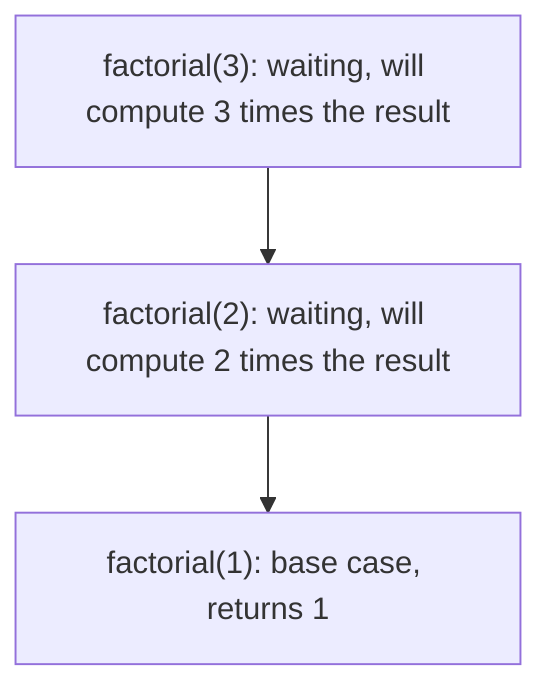
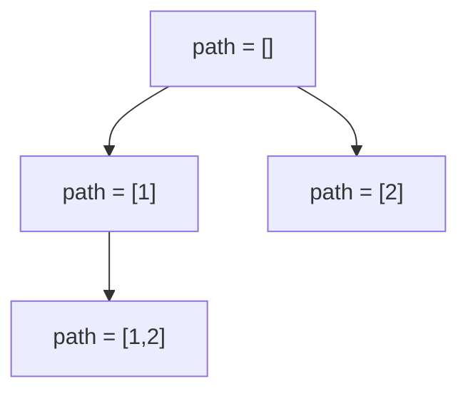

> **In one sentence:** Recursion means a function solves a problem by calling **itself** on a smaller version of the same problem, and the computer keeps track of all the unfinished calls on a structure called the **call stack**. Trees, graphs, backtracking, divide and conquer and dynamic programming are all built on it.

## 1. What is recursion?

A recursive function is one that calls itself. That sounds circular, so start with a real-life picture.

You are in a long queue and want to know your position. You cannot see the front, so you ask the person ahead: "what is your position?" They ask the person ahead of them, and so on, until the first person says "I am number 1." That answer travels back: the second person says "2", the third says "3", ... until it reaches you.

Two things made that work:

1. **A stopping point.** The first person knows the answer without asking anyone.
2. **A smaller question.** Everyone else asks the same question of someone who is one step closer to the front.

Every correct recursive function has exactly those two parts.

```java
int position(Person p) {
    if (p.isFirst()) return 1;              // 1. base case: answer directly
    return 1 + position(p.personAhead());   // 2. recursive case: same question, smaller problem
}
```

**Vocabulary you will keep hearing:**

| Term | Meaning |
|---|---|
| **Base case** | The input so small that the answer is known directly. No further call is made. |
| **Recursive case** | The part that calls the function again on a smaller input. |
| **Recursive call** | One execution of the function from inside itself. |
| **Depth** | How many calls are waiting on top of each other at the deepest moment. |
| **Call stack** | The memory structure that remembers every unfinished call. |
| **Stack frame** | One entry on the call stack, belonging to one call. |

## 2. The three rules of a correct recursive function

If you remember only one section, remember this one.

1. **Have a base case.** Without one, the function calls itself forever until the program crashes.
2. **Move toward the base case.** Each call must make the input strictly "smaller" (a smaller number, a shorter list, a node closer to a leaf). If a call can reproduce the same input, you get infinite recursion.
3. **Trust the recursive call (the "leap of faith").** While writing the function, assume the recursive call already returns the correct answer for the smaller input. Your only job is to build the answer for the current input out of that trusted result.

Here is factorial, `n! = n × (n−1) × ... × 1`, written using those rules:

```java
long factorial(int n) {
    if (n <= 1) return 1;            // base case: 0! = 1! = 1
    return n * factorial(n - 1);     // trust factorial(n-1); multiply by n
}
```

The mathematical definition already looks recursive: `n! = n × (n−1)!`. The code is a direct translation.

> **A missing base case is the number one bug.** `int sum(int n) { return n + sum(n - 1); }` never stops. It keeps calling with `n = 0, -1, -2, ...` until Java throws `StackOverflowError`.

## 3. The call stack: what the computer really does

To understand recursion (and to debug it), you need to know where the "unfinished calls" live.

### 3.1 Memory in a running program

A running program's memory has two regions that matter here:

| Region | What lives there | How it is managed |
|---|---|---|
| **Stack** | Local variables and bookkeeping for every function call that is currently active | Automatic. Grows on a call, shrinks on a return. |
| **Heap** | Objects created with `new` (arrays, lists, strings, tree nodes) | Lives until nothing references it (garbage collected in Java). |

Each function call gets its own **stack frame** on the stack. A frame holds:

- the **parameters** the function received,
- its **local variables** (primitives directly; for objects, just the reference, while the object itself is on the heap),
- the **return address**: where to continue in the caller once this call finishes,
- (and other bookkeeping the runtime needs).

### 3.2 Why a stack, and how it behaves

Calls are **last in, first out (LIFO)**: the function called most recently must finish before the one that called it can continue. That is exactly what a stack data structure does. Two operations happen:

- **Call:** push a new frame onto the top.
- **Return:** pop the top frame, hand the return value back to the frame now on top, and resume the caller right after the call.

### 3.3 Tracing `factorial(3)` step by step

```java
long factorial(int n) {
    if (n <= 1) return 1;
    return n * factorial(n - 1);
}
```

**Going down (each call pushes a frame and waits):**

```text
Step 1: main calls factorial(3)
        +--------------------------------+
        | factorial(3)  n=3  needs f(2)  |  <- top
        +--------------------------------+
        | main                           |
        +--------------------------------+

Step 2: factorial(3) calls factorial(2)
        +--------------------------------+
        | factorial(2)  n=2  needs f(1)  |  <- top
        +--------------------------------+
        | factorial(3)  n=3  waiting     |
        +--------------------------------+
        | main                           |
        +--------------------------------+

Step 3: factorial(2) calls factorial(1). This is the base case.
        +--------------------------------+
        | factorial(1)  n=1  returns 1   |  <- top
        +--------------------------------+
        | factorial(2)  n=2  waiting     |
        +--------------------------------+
        | factorial(3)  n=3  waiting     |
        +--------------------------------+
        | main                           |
        +--------------------------------+
```

**Coming back up (each return pops a frame and finishes the multiplication that was waiting):**

```text
factorial(1) returns 1          -> frame popped
factorial(2) computes 2 * 1 = 2 -> returns 2, frame popped
factorial(3) computes 3 * 2 = 6 -> returns 6, frame popped
main receives 6
```

The same story as a picture:



**Key observation:** all the multiplications happen on the way **back up**. The frames waiting on the stack are what "remember" that `3 *` and `2 *` still need to be done.

### 3.4 Order matters: work before or after the call

Where you put a line relative to the recursive call changes the output order.

```java
void countDown(int n) {
    if (n == 0) return;
    System.out.print(n + " ");   // work BEFORE the call (on the way down)
    countDown(n - 1);
}
// countDown(3) prints: 3 2 1

void countUp(int n) {
    if (n == 0) return;
    countUp(n - 1);
    System.out.print(n + " ");   // work AFTER the call (on the way back up)
}
// countUp(3) prints: 1 2 3
```

This is exactly the difference between **preorder** and **postorder** tree traversal, which you will meet later.

### 3.5 Stack overflow

The stack has a **fixed size**. Every active call uses part of it. If the recursion goes too deep, the stack runs out and the program crashes.

| Language | What happens | Roughly how deep you can go |
|---|---|---|
| Java | `StackOverflowError` | about 10,000 to 20,000 simple frames (default stack is typically 512 KB to 1 MB per thread; bigger frames mean less depth) |
| Python | `RecursionError` | 1,000 by default (`sys.getrecursionlimit()`) |
| JavaScript | `RangeError: Maximum call stack size exceeded` | around 10,000, depends on the engine |
| C / C++ | crash (segmentation fault) | depends on the stack size, often about 8 MB on Linux |

These numbers are approximate and vary by machine and frame size. The practical lesson: **if the recursion depth can reach 10⁵ or more, do not use plain recursion.** Convert it to a loop (section 9).

## 4. A recipe for writing any recursive function

Follow these five steps, in order, every time.

1. **Write the function's contract in one sentence.** For example: "`sumList(node)` returns the sum of all values from this node to the end of the list." Everything else depends on this sentence being precise.
2. **Find the base case(s).** What is the smallest input, and what is its answer? (Empty list → 0. Node is null → 0. `n == 0` → 1.) There can be more than one.
3. **Assume the contract holds for smaller inputs** (the leap of faith), and write the recursive case using it. For a list: "my answer is my own value plus `sumList(next)`."
4. **Check progress.** Does every recursive call get strictly closer to a base case? Could two branches loop back to the same input?
5. **Check cost.** Estimate the number of calls (time) and the maximum depth (stack space). Is the depth safe?

```java
// Contract: returns the sum of values from this node to the end of the list.
int sumList(ListNode node) {
    if (node == null) return 0;              // base case: empty list
    return node.val + sumList(node.next);    // trust sumList(next)
}
```

## 5. Kinds of recursion

### 5.1 Linear recursion: one call per level

```java
int sumTo(int n) {                 // 1 + 2 + ... + n
    if (n == 0) return 0;
    return n + sumTo(n - 1);
}
```

The calls form a straight chain: `n` calls deep, one after another. Time O(n), stack space O(n).

### 5.2 Binary (tree) recursion: two calls per level

```java
int maxDepth(TreeNode node) {
    if (node == null) return 0;
    return 1 + Math.max(maxDepth(node.left), maxDepth(node.right));
}
```

The calls form a **tree**. Each node of a binary tree is visited once, so time is O(n). The stack holds only one root-to-current path at a time, so stack space is O(height).

### 5.3 Multiple recursion: many calls per level

Generating all subsets, permutations or combinations makes a recursive call for each choice. The number of calls can grow exponentially, so these are the algorithms where cost analysis matters most.

### 5.4 Tail recursion: the recursive call is the very last thing

A call is a **tail call** when nothing is left to do after it returns; its result is returned as is.

```java
// NOT tail recursive: after factorial(n-1) returns, we still multiply by n
long factorial(int n) {
    if (n <= 1) return 1;
    return n * factorial(n - 1);
}

// Tail recursive: the running product is carried in `acc`, nothing is pending
long factorialTail(int n, long acc) {
    if (n <= 1) return acc;
    return factorialTail(n - 1, acc * n);
}
```

Some languages (Scheme, Scala with `@tailrec`, Kotlin with `tailrec`) reuse the same frame for a tail call, so the depth never grows (this is **tail call optimization**, TCO). **Java and Python do not do TCO**, so `factorialTail` still uses O(n) stack in Java. It is still worth knowing because the idea of carrying an **accumulator** parameter is the first step toward turning recursion into a loop.

### 5.5 Mutual recursion: two functions calling each other

```java
boolean isEven(int n) { return n == 0 ? true  : isOdd(n - 1); }
boolean isOdd(int n)  { return n == 0 ? false : isEven(n - 1); }
```

Rare in interviews, but it appears in parsers and state machines.

## 6. Two ways to get an answer out: return it up, or pass it down

Recursive functions communicate in two directions. Knowing which one you are using prevents most confusion.

**Return-up (the answer is built from children's answers):**

```java
int maxDepth(TreeNode node) {
    if (node == null) return 0;
    return 1 + Math.max(maxDepth(node.left), maxDepth(node.right));
}
```

**Pass-down (information flows in through parameters, and a result is recorded somewhere):**

```java
int best = 0;

void dfs(TreeNode node, int depth) {
    if (node == null) return;
    best = Math.max(best, depth);
    dfs(node.left, depth + 1);      // depth is passed DOWN
    dfs(node.right, depth + 1);
}
// call: dfs(root, 1)
```

| | Return-up | Pass-down |
|---|---|---|
| Best for | computing a value from subresults (height, sum, count) | carrying context (path so far, remaining budget, current depth) |
| Result lives in | the return value | a field, an output list, or a parameter that collects it |
| Typical use | tree DP, divide and conquer | backtracking, path problems |

Many solutions use **both**: pass the context down and return a partial result up.

## 7. Cost analysis of recursion

### 7.1 Time: count the calls, and the work per call

Write a **recurrence** and solve it (you saw the method in the Big-O topic). Or draw the **recursion tree**: total time = sum of the work at every node.

### 7.2 Space: it is the maximum depth, not the number of calls

This is the most common mistake in interviews. The call stack holds only the calls that are **currently active**: one chain from the first call down to the one running now. Finished calls have already been popped.

So: **stack space = maximum depth × size of one frame** (plus any other memory you allocate).

| Function | Total calls (time) | Max depth (stack space) |
|---|---|---|
| `factorial(n)` | n | n, so O(n) |
| `fib(n)` naive | about φⁿ (exponential) | n, so **O(n)**, not exponential |
| Binary search (recursive) | log n | log n |
| Fast power (`x^n`) | log n | log n |
| Tree DFS | n (every node) | height h: O(log n) if balanced, O(n) if it is a chain |
| Subsets (all 2ⁿ) | about 2ⁿ | n |
| Tower of Hanoi | 2ⁿ − 1 | n |
| Merge sort | about 2n | log n (plus O(n) for the merge buffer) |

> That is why naive Fibonacci is extremely slow but does **not** run out of stack for moderate `n`: its time is exponential, but its depth is only `n`.

### 7.3 Recursion versus iteration

| | Recursion | Loop |
|---|---|---|
| Stack space | O(depth) | usually O(1) |
| Speed | small overhead per call | slightly faster |
| Clarity | natural for trees, graphs, backtracking, self-similar problems | natural for simple repetition |
| Risk | stack overflow on deep input | none |

Any recursion can be rewritten as a loop with an explicit stack (section 9). Use recursion when it makes the solution simpler and the depth is safe.

## 8. The patterns you will use again and again

### 8.1 Divide and conquer

Split the problem into independent smaller pieces, solve each recursively, combine the results. Examples: merge sort, quick sort, binary search, building a balanced tree from a sorted array.

### 8.2 Fast exponentiation: cutting the work in half

Computing `x^n` by multiplying `n` times is O(n). But `x^n = (x^(n/2))²`, so compute the half **once** and square it.

```java
double power(double x, long n) {
    if (n == 0) return 1;
    if (n < 0) return 1 / power(x, -n);
    double half = power(x, n / 2);              // ONE recursive call
    return n % 2 == 0 ? half * half : half * half * x;
}
```

Time O(log n), stack O(log n). Note the two subtle points:

- **Call it once.** Writing `power(x, n/2) * power(x, n/2)` makes two calls per level, and the time falls back to O(n). Storing the result in `half` is what gives O(log n).
- **Use `long` for `n`.** In Java, `-Integer.MIN_VALUE` overflows `int`, so negating the exponent as an `int` breaks for the smallest value.

### 8.3 Backtracking: choose, explore, un-choose

Build a solution one decision at a time. After exploring a choice, **undo it** so the next choice starts from a clean state.

```java
void subsets(int[] nums, int start, List<Integer> path, List<List<Integer>> result) {
    result.add(new ArrayList<>(path));           // record a COPY of the current path
    for (int i = start; i < nums.length; i++) {
        path.add(nums[i]);                        // choose
        subsets(nums, i + 1, path, result);       // explore
        path.remove(path.size() - 1);             // un-choose (backtrack)
    }
}
```

For `nums = [1, 2]` the calls form this tree, and every node contributes one subset (`[]`, `[1]`, `[1,2]`, `[2]`):



Two things to notice:

- **Copy the path** (`new ArrayList<>(path)`) when saving it. If you add `path` itself, every saved entry points at the same list, which keeps changing.
- **Undo every change** you make. Forgetting the `remove` is the most common backtracking bug.

### 8.4 Recursion on linked lists

A list is "a node followed by a smaller list", which is naturally recursive. Reversing a list recursively:

```java
ListNode reverse(ListNode head) {
    if (head == null || head.next == null) return head;   // empty or one node
    ListNode newHead = reverse(head.next);                // reverse the rest (leap of faith)
    head.next.next = head;                                // make the next node point back to me
    head.next = null;                                     // I am now the tail
    return newHead;
}
```

Time O(n), stack space O(n). The iterative version uses O(1) space, which is worth mentioning in an interview.

### 8.5 Recursion on trees

Almost every tree problem is: "do something for the node, recurse on left, recurse on right, combine". You will use this pattern in the Binary Tree topic and everywhere after it.

### 8.6 Memoization: remembering answers

When the same subproblem is solved again and again, store the answers. Naive Fibonacci recomputes the same values exponentially many times; a cache makes it linear.

```java
long fib(int n, long[] memo) {
    if (n <= 1) return n;
    if (memo[n] != 0) return memo[n];                       // already computed
    return memo[n] = fib(n - 1, memo) + fib(n - 2, memo);   // compute once, store
}
```

The tree of calls collapses from about φⁿ calls to about `2n`, so time is O(n) and space is O(n). This is the core idea of **dynamic programming** (its own topic later): recursion plus a cache.

## 9. Turning recursion into a loop with an explicit stack

Because recursion just uses the call stack, you can manage a stack yourself. This removes the risk of `StackOverflowError`, which matters when the depth can be very large.

Recursive preorder traversal of a tree:

```java
void preorder(TreeNode root) {
    if (root == null) return;
    visit(root);
    preorder(root.left);
    preorder(root.right);
}
```

The same thing with your own stack:

```java
void preorder(TreeNode root) {
    if (root == null) return;
    Deque<TreeNode> stack = new ArrayDeque<>();
    stack.push(root);
    while (!stack.isEmpty()) {
        TreeNode node = stack.pop();
        visit(node);
        if (node.right != null) stack.push(node.right);   // pushed first, so it is visited last
        if (node.left != null) stack.push(node.left);
    }
}
```

The order of the pushes matters: the stack is last-in-first-out, so push the child you want to visit **later** first.

**The general method:**

1. Put what the recursive call would receive (its parameters) into your own stack.
2. While the stack is not empty: pop, do the work, push the "recursive calls" you would have made.
3. If work must happen **after** the children finish (like postorder), you need extra state on the stack (for example a "visited" flag).

## 10. Classic recursive functions to know by heart

| Problem | Recursive idea | Time | Stack space |
|---|---|---|---|
| Factorial | `n * f(n-1)`, base `f(1) = 1` | O(n) | O(n) |
| Sum of digits | `n % 10 + f(n / 10)`, base `n == 0` | O(log n) | O(log n) |
| Reverse a string | swap ends, recurse on the middle | O(n) | O(n) |
| Palindrome check | ends equal and middle is a palindrome | O(n) | O(n) |
| GCD (Euclid) | `gcd(a, b) = gcd(b, a % b)`, base `b == 0` | O(log min(a, b)) | O(log min(a, b)) |
| Fibonacci | `f(n-1) + f(n-2)` | O(φⁿ), or O(n) with memo | O(n) |
| Fast power | halve the exponent | O(log n) | O(log n) |
| Tower of Hanoi | move n−1, move the largest, move n−1 | O(2ⁿ) | O(n) |
| Subsets | choose or skip each element | O(n · 2ⁿ) | O(n) |
| Permutations | choose the next unused element | O(n · n!) | O(n) |

Two of them in code:

```java
int gcd(int a, int b) {
    if (b == 0) return a;
    return gcd(b, a % b);        // the remainder shrinks quickly, so the depth is O(log)
}

boolean isPalindrome(String s, int left, int right) {
    if (left >= right) return true;                      // zero or one character left
    if (s.charAt(left) != s.charAt(right)) return false; // mismatch: stop early
    return isPalindrome(s, left + 1, right - 1);         // check the inside
}
```

**Tower of Hanoi** deserves a note because it explains exponential recursion. To move `n` disks, move `n−1` disks away, move the biggest, then move `n−1` disks back on top: `T(n) = 2·T(n−1) + 1`, which gives `2ⁿ − 1` moves. Adding one disk **doubles** the work.

## 11. Common bugs and how to avoid them

| Bug | Symptom | Fix |
|---|---|---|
| No base case | `StackOverflowError` | Write the base case first, before the recursive case. |
| Base case never reached | `StackOverflowError` | Check every call moves toward it (`n - 1` not `n + 1`; `mid + 1` not `mid`). |
| Wrong or missing return | wrong answer, often `0` or `null` | Return the recursive result: `return f(n - 1)`, not just `f(n - 1)`. |
| Two calls where one is enough | time blows up (e.g. O(n) becomes exponential) | Store the result in a variable and reuse it, or memoize. |
| Recomputing overlapping subproblems | exponential time | Add a memo (dynamic programming). |
| Forgetting to undo a change (backtracking) | wrong or repeated results | Reverse every modification after the recursive call. |
| Saving a reference instead of a copy | all saved results look identical or empty | Save `new ArrayList<>(path)`. |
| Off-by-one in the base case | crashes on empty input or misses the last element | Test the smallest inputs: empty, one element, two elements. |
| Depth too large | `StackOverflowError` on big inputs | Use a loop or an explicit stack. |

**How to debug:** draw the recursion tree for a tiny input (`n = 3` or `4`), and write the value each call returns next to it. If it is hard to draw, print with indentation by depth:

```java
int fact(int n, int depth) {
    String pad = "  ".repeat(depth);
    System.out.println(pad + "fact(" + n + ")");
    if (n <= 1) return 1;
    int result = n * fact(n - 1, depth + 1);
    System.out.println(pad + "returns " + result);
    return result;
}
```

## 12. Recursion in interviews

- **Recognize when to use it:** trees and graphs, "all combinations/permutations/subsets", a problem that splits into smaller identical problems, or a definition that refers to itself.
- **Say the contract out loud** before coding: "`helper(node)` returns the height of the subtree at `node`."
- **State the base cases and prove progress** in one sentence each.
- **Give both costs:** "Time is O(n) because each node is visited once, and stack space is O(h) where h is the height of the tree."
- **Ask about the input size.** If the depth can reach 10⁵ or more (a skewed tree, a long linked list), mention the risk of stack overflow and offer an iterative version.
- **Mention the trade-off:** "The iterative solution uses O(1) extra space, the recursive one is shorter but uses O(n) stack."
- **Spot overlapping subproblems.** If the recursion tree repeats states, say "this needs memoization" and add a cache.

## 13. Practice: trace and analyze

Work these out on paper before reading the answers.

**A.** What does each call print?

```java
void f(int n) { if (n == 0) return; System.out.print(n + " "); f(n - 1); }
void g(int n) { if (n == 0) return; g(n - 1); System.out.print(n + " "); }
// call f(3) and g(3)
```

**B.** Time and stack space of:

```java
int h(int n) {
    if (n <= 1) return 1;
    return h(n - 1) + h(n - 1);
}
```

**C.** What is wrong with this, and what happens when it runs?

```java
int sum(int n) {
    return n + sum(n - 1);
}
```

**D.** Time and stack space of:

```java
int count(int n) {
    if (n <= 0) return 0;
    return 1 + count(n / 2);
}
```

**E.** What does `mystery(5)` return, and what does the function compute?

```java
int mystery(int n) {
    if (n == 0) return 0;
    return n % 2 + mystery(n / 2);
}
```

**F.** Naive `fib(n)` has exponential time. What is its stack space, and why?

### Answer key

- **A:** `f(3)` prints `3 2 1` (work before the call). `g(3)` prints `1 2 3` (work after the call).
- **B: O(2ⁿ) time, O(n) space.** `T(n) = 2T(n−1) + O(1)` gives about 2ⁿ calls, but the depth is only `n`. (Storing `h(n-1)` in a variable and adding it to itself would make it O(n) time.)
- **C:** There is no base case, so it never stops. The depth keeps growing until Java throws `StackOverflowError`.
- **D: O(log n) time and O(log n) space.** `n` halves each call, so there are about log₂ n calls stacked up.
- **E: returns 2.** `5 → 1 + mystery(2)`, `2 → 0 + mystery(1)`, `1 → 1 + mystery(0)`, `mystery(0) = 0`. Total `1 + 0 + 1 = 2`. It counts the number of **1 bits** in the binary form of `n` (`5 = 101`).
- **F: O(n).** The stack holds only the current chain of calls, and the longest chain is `fib(n) → fib(n-1) → ... → fib(1)`, which is `n` frames. Finished calls are popped, so the exponential number of calls never sit on the stack together.

## 14. Practice problems (LeetCode)

For each one, write the contract, the base case and the cost before you code.

1. **Maximum Depth of Binary Tree** (LeetCode 104, Easy). The cleanest "return-up" recursion: `1 + max(left, right)`. State time O(n) and stack space O(h).
2. **Reverse Linked List** (LeetCode 206, Easy). Solve it recursively (O(n) stack) and iteratively (O(1) space), and explain the trade-off.
3. **Pow(x, n)** (LeetCode 50, Medium). Halve the exponent for O(log n). Handle negative `n` and the `Integer.MIN_VALUE` overflow, and make sure you make only **one** recursive call per level.
4. **Subsets** (LeetCode 78, Medium). The choose, explore, un-choose pattern. Remember to save a copy of the path.
5. **Generate Parentheses** (LeetCode 22, Medium). Build strings one character at a time and **prune** any branch that can no longer become valid (never more closing than opening brackets). This shows how pruning shrinks the recursion tree.

## 15. Key takeaways

- A recursive function needs a **base case**, a call on a **smaller** input, and the **leap of faith** that the call works.
- The **call stack** stores one frame per active call (parameters, locals, return address). Calls go down first, and the pending work finishes on the way **back up**.
- **Stack space is the maximum depth**, not the total number of calls. Time comes from counting calls (draw the recursion tree or write the recurrence).
- The stack is finite: very deep recursion throws a stack overflow, so switch to a loop or an explicit stack when depth can be huge.
- Know the patterns: **divide and conquer**, **backtracking** (choose, explore, un-choose), **tree/list recursion**, and **memoization** for overlapping subproblems.
- Java has no tail call optimization, so a tail-recursive function still uses O(n) stack.
- Typical bugs: missing base case, no progress toward it, forgetting to undo a change, saving a reference instead of a copy, and calling twice where one call would do.
