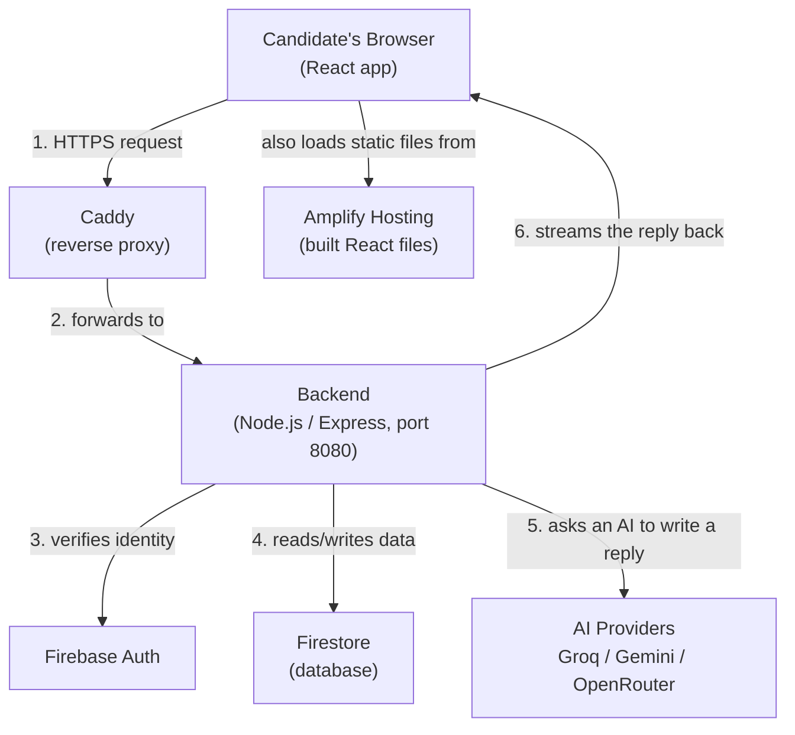

# 2. The Big Picture: How the Pieces Fit Together

This platform has four kinds of moving parts. This file explains what each one is for and how a request
flows through all of them. Later files zoom into each box individually.

## The four kinds of pieces

### 1. The frontend (what the user sees)
A React application that runs entirely **inside the user's browser**. It draws every page (Landing, Interview,
Scorecard, Admin, …), keeps track of "am I logged in," and is the *only* thing that talks directly to the
user. It never touches the database directly — for anything real (starting an interview, reading history), it
calls the backend's API over the internet. Deep dive: [03_frontend_deep_dive.md](03_frontend_deep_dive.md).

### 2. The backend (the rules and the work)
A Node.js server (using the Express framework) that exposes a set of URLs like `/api/sessions` and
`/api/admin/stats`. Every single thing the frontend is allowed to do goes through here first — the backend
checks "is this person logged in?", "have they used up their daily quota?", "does the data they sent make
sense?" — and only then does the real work: saving to the database, or asking an AI for a reply.
Deep dive: [04_backend_deep_dive.md](04_backend_deep_dive.md).

> 🧠 **In plain English:** the frontend can *ask* for almost anything, but it's the backend that actually
> *decides* what's allowed to happen. This separation is what keeps the app secure — a user editing their
> browser's code can't grant themselves admin rights, because the backend independently checks the real
> Firestore record for their role on every request.

### 3. Firestore (the database)
A cloud database made by Google. It stores every user's profile, every interview session's transcript, every
DSA-sheet checkbox, every "loop," and the platform-wide settings. It has no concept of "web pages" — it's
purely a place to durably store and query structured data. Deep dive:
[06_database_and_data_model.md](06_database_and_data_model.md).

### 4. The AI providers (the "interviewer" and "grader")
The backend doesn't run its own AI — it sends a request over the internet to one of three companies (Groq,
Google Gemini, or OpenRouter) with a big block of instructions (the "prompt") plus the conversation so far,
and that company's model generates the interviewer's next reply. Deep dive:
[07_ai_integration_explained.md](07_ai_integration_explained.md).

## Two supporting services worth knowing about early

- **Firebase Auth** is a separate Google service (not Firestore) that handles the actual login: passwords,
  "Sign in with Google," etc. Once a user signs in, Firebase Auth hands the frontend a signed **ID token**.
  The frontend attaches that token to every API call, and the backend asks Firebase Auth's library to verify
  it's genuine before trusting `req.user`.
- **Firebase App Check** is a second, separate proof — not "who is this user" but "is this request really
  coming from our real website's code." It stops someone from copying the API URLs into a script and hitting
  them directly, bypassing the real app.

Both are explained in full in [05_authentication_and_access_control.md](05_authentication_and_access_control.md).

## Tracing one request, end to end (short version)

Say a user clicks **"Send"** on a chat message during a mock interview:

1. The **frontend** calls `POST /api/sessions/:id/turns` with the message text, attaching the user's Firebase
   ID token and App Check token in the request headers.
2. **Caddy** (the reverse proxy on the production server) receives the HTTPS request on the public domain and
   forwards it, unencrypted, to the Node.js process listening on `localhost:8080`.
3. The **backend**'s middleware chain runs in order: it assigns a request ID, adds security headers, checks the
   request's origin is allowed (CORS), applies a rate limit, verifies the App Check token, verifies the
   Firebase ID token, and loads/validates the user's profile (ban/suspend/quota checks).
4. The matching **route handler** (in `backend/routes/sessions.js`) loads the session from **Firestore**,
   builds the full conversation + system prompt, and calls the **AI gateway**.
5. The AI gateway picks a model, sends the request to (say) **Groq**, and streams the tokens back through the
   backend to the frontend as they're generated (Server-Sent Events), so the reply appears to type itself out.
6. Once the reply is complete, the backend saves the updated transcript back to **Firestore** and closes the
   stream.

This exact flow, with every file and function name involved, is walked through in full in
[08_interview_session_lifecycle.md](08_interview_session_lifecycle.md).

## Where does the code actually run?

- The **frontend**'s built static files are hosted on **AWS Amplify Hosting** (or served locally by Vite during
  development).
- The **backend** runs as a long-lived Node.js process on a server (an EC2-style machine), reachable through
  **Caddy**, which handles the public domain name and (in production) TLS/HTTPS certificates.
- Full detail: [10_infrastructure_and_deployment.md](10_infrastructure_and_deployment.md).

---
Next: zoom into the browser side → [03_frontend_deep_dive.md](03_frontend_deep_dive.md)
