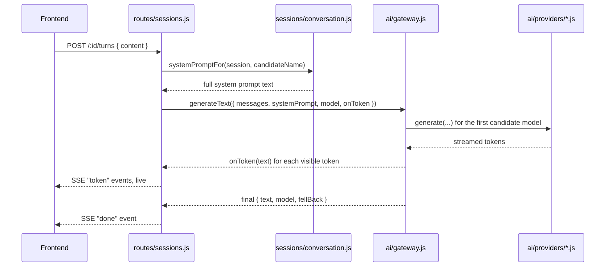

# 7. AI Integration Explained — Talking to Groq, Gemini, and OpenRouter

This is the part of the system that makes the "AI interviewer" actually work. It has three layers: **which
models exist** (the registry), **how a reply is actually generated, with fallback** (the gateway), and **what
instructions we send** (the prompts).

## 7.1 The model registry — `services/ai/modelRegistry.js`

A single hardcoded list (`MODELS`) is the source of truth for every AI model the platform knows about. Each
entry has an `id` (e.g. `qwen/qwen3.8-27b`), which `provider` it belongs to (`groq`, `gemini`, or
`openrouter`), a display `name`/`icon`/`description` for the frontend's dropdown, and rate-limit hints
(`rpm`/`rpd` — requests per minute/day the *provider itself* allows).

A few important mechanisms live here:

- **`ALIASES`** — a map of old/decommissioned model IDs (e.g. `llama-3.1-8b-instant`, which Groq later removed)
  to their current replacement. This means sessions saved months ago, still referencing a model that no
  longer exists, keep working instead of erroring.
- **`isProviderConfigured(provider)`** — a provider only "counts" as usable if its API key
  (`GROQ_API_KEY`/`GEMINI_API_KEY`/`OPENROUTER_API_KEY`) is actually set in the environment. This lets the
  platform run with only some providers configured (e.g. locally with just one free key).
- **`FALLBACK_ORDER`** — the sequence of models to try, cheapest/fastest first, if the requested one is
  unavailable.
- **`PURPOSE_DEFAULTS`** — `chat` defaults to the fast Qwen model; `scorecard` and `notes` default to the
  larger GPT-OSS-120B model, because generating a structured JSON scorecard or ~4,000 words of notes needs
  more output capacity than Groq's per-request cap allows for the small model.
- **`buildChain(requestedId, purpose)`** — returns the ordered list of models to actually try: the user's
  requested model first (if it's real and enabled), then every other enabled model in fallback order.

## 7.2 The gateway — `services/ai/gateway.js`

This is where a request actually gets sent, with automatic fallback. `generateText({ messages, systemPrompt,
model, purpose, onToken, ... })` does the following:

1. Builds the candidate chain via the registry.
2. Skips any model currently in a **cooldown** (see below).
3. Tries each candidate model, in order, until one succeeds:
   - Each attempt gets its own timeout: 90 seconds for a normal (non-streaming) request, or 45 seconds of
     *no new tokens* for a streaming one (the clock resets every time a new token arrives, so a slow-but-alive
     stream isn't killed).
   - The actual provider-specific call is delegated to `PROVIDERS[candidate.provider].generate(...)` — see
     §7.3.
   - If `onToken` was given (a streaming request), each raw chunk is first passed through a **"thinking"
     filter** (`services/ai/thinking.js`) that strips out any "reasoning" text some models emit before their
     real answer, so the user only ever sees the final, clean reply appearing token by token.
   - If a model fails **before** it emitted any visible text, the gateway quietly moves on to the *next*
     candidate — the user never sees this failure. If it fails **after** some text was already shown, it can't
     silently retry (that would duplicate/corrupt what the user already saw), so it surfaces a clear
     `AI_STREAM_INTERRUPTED` error asking them to resend.
4. If **every** candidate fails, it returns a `503 AI_UNAVAILABLE` error with a `retryAfter` hint.

### Cooldowns (a simple circuit breaker)

When a model fails, `cooldownFor(err)` decides how long to "bench" that specific model before trying it again
on a *future* request (not this one) — this avoids hammering a provider that's clearly broken, and avoids
wasting a user's wait time repeatedly trying something that just failed:

| Failure looks like | Cooldown |
|---|---|
| 404 / "model decommissioned" | 6 hours |
| 401 / 403 (bad credentials) | 1 hour |
| 429 / quota / rate-limited | 1 minute |
| anything else | 20 seconds |

## 7.3 The provider adapters — `services/ai/providers/{groq,gemini,openrouter}.js`

Each of these files adapts one company's specific SDK/HTTP API to the same shape the gateway expects: a
`generate({ messages, systemPrompt, model, signal, onToken, maxTokens, temperature })` function that either
returns the full text, or calls `onToken` repeatedly while streaming. This is what lets the gateway treat all
three providers identically — it never needs to know their individual quirks.

## 7.4 The prompts — `services/prompts.js`

This file is the actual "personality and rulebook" text sent to the model before every conversation.

- **`CORE_RULES`** — sent with *every single* interview type. Key rules:
  - **Anti-recitation**: never quote a well-known problem statement or canonical solution verbatim (this
    avoids a real failure mode where Google's API blocks a response for looking like copied text).
  - **No visible thinking**: never show hesitation or self-correction ("wait, let me reconsider...") — only
    the final, clean message.
  - **Markdown formatting rules**, including: don't repeat the difficulty/language/company, since the UI
    already shows those as badges above the chat.
  - **Mermaid diagram rules**, for when a user asks for a visual "dry run" of an algorithm.
- **`DSA_PROBLEM_FORMAT`** (only added for `dsa`/`tutorDsa`) — forces a strict "Problem / Example / Constraints"
  structure, since coding problems specifically benefit from that shape (design and behavioral rounds do not).
- **`BASE_PROMPTS`** — one full persona/instructions block per interview type (`dsa`, `systemDesign`, `lld`,
  `managerial`, and their `tutor*` equivalents), describing how that *kind* of interview should progress stage
  by stage (e.g. DSA goes: understand → dry-run edge cases → code → evaluate).
- **`buildDSAProblemBlock` / `buildSDProblemBlock` / `buildLLDProblemBlock`** — each takes the actual selected
  question data and turns it into an `[ASSIGNED_PROBLEM]` block appended to the base prompt. Each of these
  deliberately splits the text into:
  - the part that should be **presented to the candidate** (title, difficulty, and — for system design —
    functional requirements up front, holding back non-functional requirements/scale until asked), and
  - a `[INTERVIEWER CONTEXT — DO NOT SHARE WITH CANDIDATE]` section containing the reference design, common
    pitfalls to probe, and deep-dive questions — visible to the model, never to the user.
- **Tutor mode** relabels that same hidden section as `[TUTOR NOTES ...]`, since a tutor is meant to *teach*
  that reference design progressively, not hide it forever.
- **`getSystemPrompt(interviewType, candidateName, { company, difficulty, language, questionData })`** is the
  single function everything else calls: it looks up the right base prompt, appends the formatting rules and
  the assigned-problem block, and fills in the candidate's name and any company-specific instruction.

## 7.5 Scoring and notes — `services/evaluation.js`

- **`buildScorecardPrompt(messages)`** — builds a *very* strict prompt for a "Principal Engineer" persona to
  grade the finished transcript, with explicit non-negotiable rules (e.g. "if the candidate never wrote real
  code, the verdict must be No Hire and the score must not exceed 30") specifically to stop the AI from being
  overly generous. It demands a raw JSON reply with `score`, `verdict`, `strengths`, `weaknesses`,
  `problemSolving`, `communication`.
- **`parseScorecard(text)`** — finds the `{ ... }` JSON block in the AI's reply and safely parses it, clamping
  the score to 0–100 and defaulting any missing field, so a slightly malformed reply still produces a usable
  scorecard rather than crashing.
- **`buildNotesPrompt(messages, language)`** — asks for structured Markdown revision notes (Intuition,
  Brute Force, Optimization, etc.) tailored to what actually happened in that specific conversation.

## 7.6 How this all comes together for one chat turn

---
Next: the same story, but for a *whole* interview from click to scorecard →
[08_interview_session_lifecycle.md](08_interview_session_lifecycle.md)
