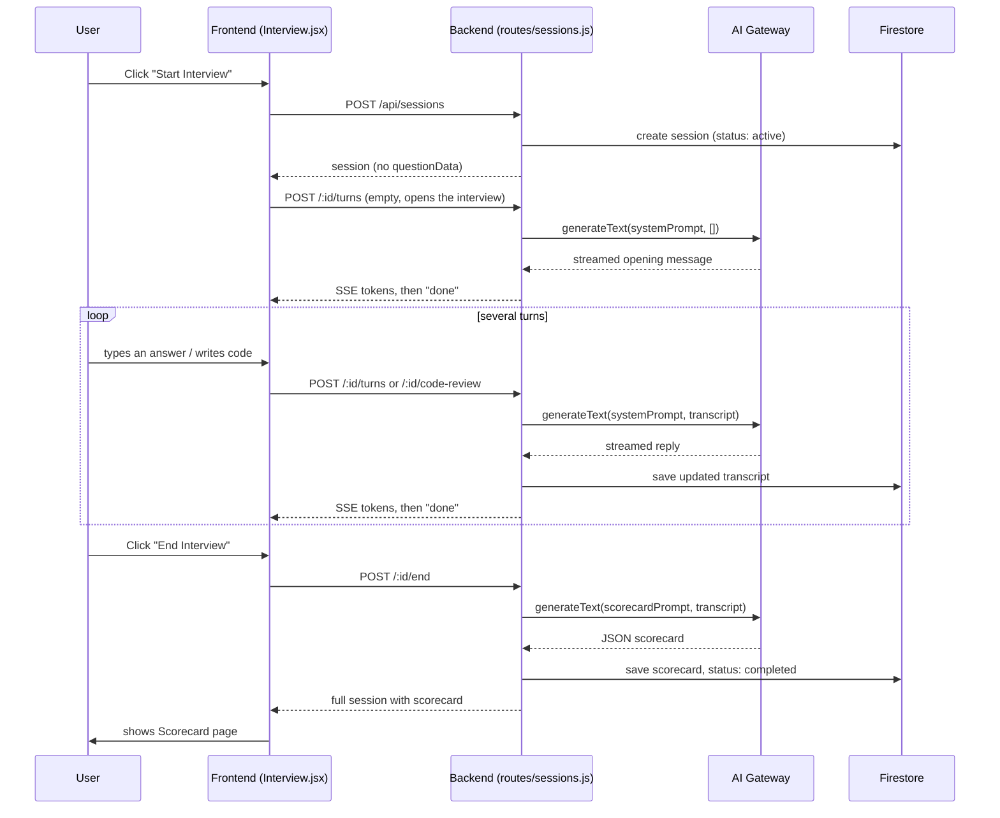

# 8. Interview Session Lifecycle — One Full Walkthrough

This file traces **one single mock interview**, end to end, naming every file and function involved. Read
[06](06_database_and_data_model.md) and [07](07_ai_integration_explained.md) first if you haven't — this file
assumes you know what a `sessions/{id}` document and the AI gateway are.

## 8.1 Step 1 — Picking a setup and starting

On the Interview page, the user picks a type, difficulty, company (optional), language, and AI model, then
clicks "Start." The frontend calls `createSession(payload)` → `POST /api/sessions`.

On the backend (`routes/sessions.js`):

1. **`validateCreate`** checks `interviewType` is one of the 7 valid values, cleans/validates the config
   (difficulty must be `EASY|MEDIUM|HARD|ANY`, text fields are trimmed and length-capped), and — if this
   session is round of an Interview Loop — checks that round actually exists, matches the requested type, and
   is the loop's *current* open round.
2. **`assertNoActiveInterview`** enforces a real-world rule: **only one timed interview can be in progress at
   once** (tutor lessons are exempt, since they're not timed or competitive). Before blocking, it first cleans
   up genuinely dead sessions automatically: a session that was created but never got its first message within
   2 minutes, or one whose timer expired with zero candidate answers, is silently closed. Anything else active
   returns `409 ACTIVE_INTERVIEW` with the existing session's summary attached, so the frontend can offer
   "Resume" or "Discard" instead of just failing.
3. **`checkUserAccess`** — the quota-consuming check from [05](05_authentication_and_access_control.md) — runs
   *after* the above, so an invalid or blocked request never "spends" a trial/daily session.
4. `getQuestion(baseType, company, difficulty, alreadyPracticedTitles)` (in `services/questionBank.js`) picks
   an unseen question from the right bank, avoiding titles the user has already practiced.
5. `store.create(...)` writes the new `sessions/{id}` document with `status: 'active'`, an empty `messages`
   array, and the timer *armed but not yet started* (`timerEndsAt: null`).
6. If this is a loop round, `updateLoopRound(...)` marks that round `'in-progress'` and links the new session's
   ID to it.
7. The new session (without its `questionData`, which never leaves the server) is returned to the frontend.

## 8.2 Step 2 — The interviewer's opening message

The frontend immediately calls `sendSessionTurn(id, {})` with **no `content`** → `POST
/api/sessions/:id/turns`. Sending an empty first turn on a session with zero messages is precisely how the AI
is prompted to open the conversation instead of react to something the user said.

Inside the handler:

- `timerStartPatch(record)` computes `timerEndsAt` **for the first time here** (clock starts when the problem
  is actually shown, not when the row was created a moment earlier).
- `convo.systemPromptFor(...)` (in `services/sessions/conversation.js`) builds the exact system prompt via
  `getSystemPrompt(...)` from [07](07_ai_integration_explained.md), including the hidden assigned-problem
  block.
- `generateText(...)` streams the reply back over Server-Sent Events as `token` events; the frontend appends
  each piece to the chat bubble live.
- Once complete, `appendAndSave` writes both the (non-existent, in this case) user message and the new
  assistant message into `messages`, via `store.saveMessages`, and a final `done` event tells the frontend the
  official saved message, the model that answered, whether it had to **fall back** to a different model, and
  the new `timerEndsAt`.

## 8.3 Step 3 — The back-and-forth conversation

Every later user message follows the same `POST /:id/turns` path, but now:

- `assertActive` — a `completed`/`archived` session can't take new turns (`409 SESSION_ENDED`).
- `assertTimeLeft` — once the timer has expired (with a 60-second grace period for slow typers), further
  messages are rejected with `409 TIME_UP`, nudging the user to end the interview instead.
- `assertRoomFor(record, 2)` — a hard cap of 100 total messages per session prevents runaway growth of a single
  Firestore document.
- **Idempotent retries**: the frontend sends a random `turnId` with each user message. If the network drops
  right as the AI's reply was about to arrive, resending the *same* `turnId` doesn't ask the AI again — the
  server notices that `turnId` was already saved and just replays the existing saved reply
  (`replayOf(existing, turnId)`), so the user never gets duplicated or double-charged messages.
- **Optimistic-concurrency safety**: `store.saveMessages` runs inside a Firestore transaction that first
  re-reads the document and checks its message count still matches what this request started from
  (`expectedCount`). If another tab/request changed it in between (e.g. the same session open in two browser
  tabs), it fails cleanly with `409 SESSION_CONFLICT` rather than silently overwriting the other tab's message.

## 8.4 Submitting code for review

`POST /:id/code-review` is a special kind of turn: the user's code is wrapped in a fenced code block and
appended as a user message. If `OPENAI_API_KEY` is configured, it first tries `services/openaiCodeAudit.js`'s
more structured `auditCode(...)`; if that's unavailable or fails, it politely falls back to asking the regular
interviewer model to review the code instead (with a short extra instruction block, `CODE_REVIEW_INSTRUCTIONS`,
telling it not to re-greet or restate the problem).

## 8.5 Step 4 — Ending the interview and getting a scorecard

`POST /:id/end` (optionally with a `scorecardModel` override):

1. If the session is already finished, it's idempotent — just returns the existing session as-is.
2. Tutor sessions simply complete with no score (`store.complete(record)`), since tutor mode isn't graded.
3. If the candidate never sent a single message and the reason is that time genuinely ran out, the session is
   silently archived as a `timeout` with no scorecard. If they never answered and time *hasn't* run out, they
   get a friendly `400 NO_ANSWERS` telling them to answer at least one question first.
4. Otherwise: `store.claimEnding(record)` sets a short "being scored" lease so a second, near-simultaneous
   "End" click (e.g. an impatient double-click) gets `409 SCORING_IN_PROGRESS` instead of triggering two
   separate, wasteful AI calls.
5. `generateText(...)` is called once more, this time with `buildScorecardPrompt(messages)` as the system
   prompt and no real user turn — just "Generate the scorecard for this interview."
6. `parseScorecard(text)` turns the AI's JSON reply into the stored `scorecard` object. If it's unparsable, the
   lease is released (so a retry is possible) and a clear `502 SCORECARD_INVALID` error is returned instead of
   silently saving garbage.
7. `store.complete(record, { scorecard })` marks the session `completed`.
8. If this was a loop round, `updateLoopRound(...)` marks that round `passed` or `failed` based on whether the
   score cleared `PASS_SCORE`, which can automatically unlock the loop's *next* round.

## 8.6 Afterward: notes, history, and pinning

- `POST /:id/notes` generates personalized revision notes **once** — calling it again just returns the
  already-saved notes rather than regenerating (and re-billing an AI call) every time the user reopens the
  page.
- `GET /api/sessions` lists every session (new + legacy, see [06](06_database_and_data_model.md)) without
  their transcripts, for the History page, with optional filters (`status`, `interviewType`, `mode`,
  `question`, `loopId`).
* `PATCH /:id` lets the owner toggle `isPinned`, save `code`/`notes` manually, or archive the session.

## 8.7 The whole thing, end to end

---
Next: the other features built on top of this same session model →
[09_feature_tours.md](09_feature_tours.md)
